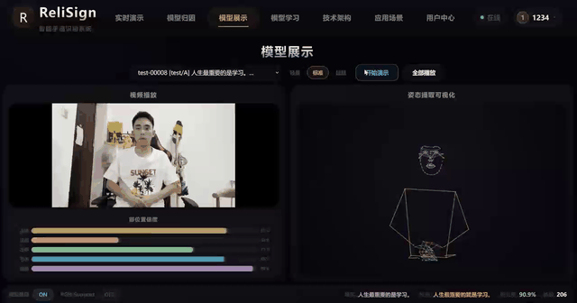
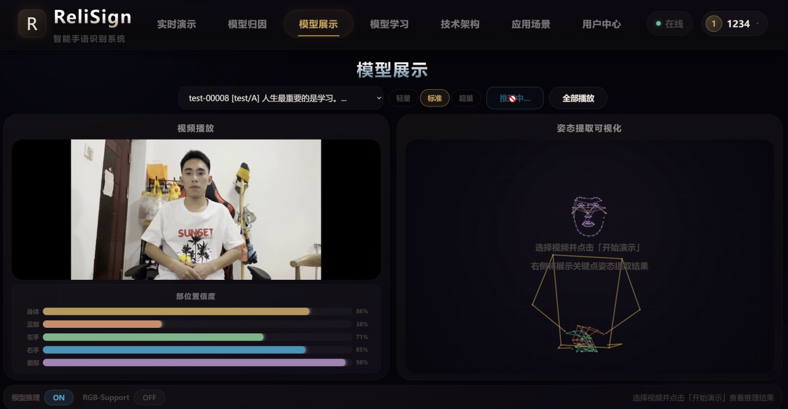
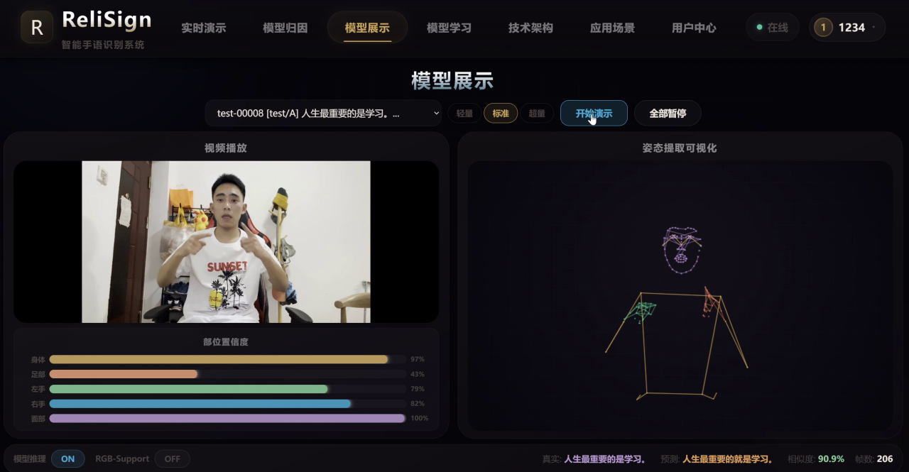
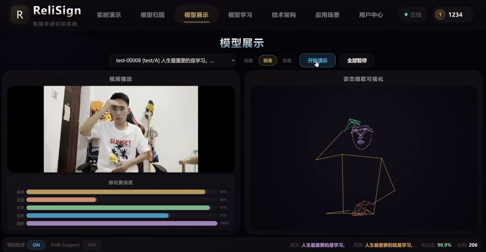
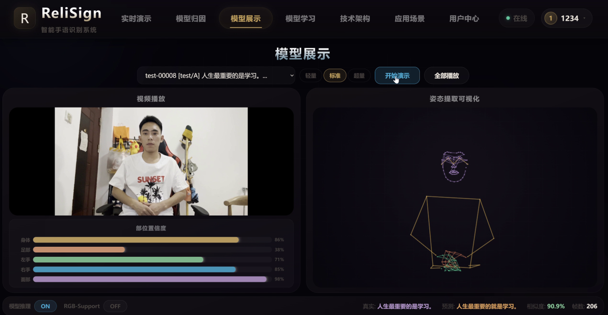
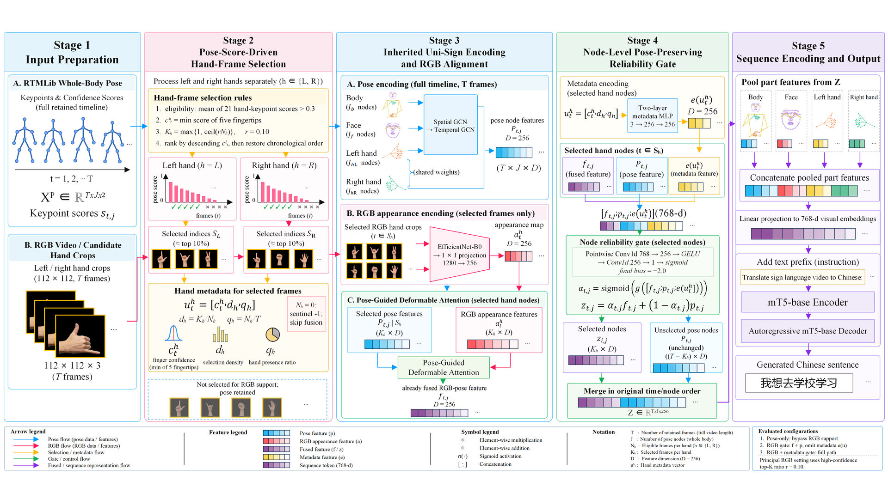

<h1 align="center">ReliSign</h1>
<h3 align="center">可靠性感知多模态手语翻译系统</h3>
<h5 align="center">Reliability-aware Multimodal Sign Language Translation</h5>
<h5 align="center"><em>Built upon <a href="https://arxiv.org/abs/2501.15187">Uni-Sign</a> (ICLR 2025)</em></h5>
<h5 align="center">如果这个项目对你有帮助，欢迎点一个 star 🌟</h5>

<h5 align="center">

[](https://arxiv.org/abs/2501.15187) 
[](https://huggingface.co/datasets/ZechengLi19/CSL-News)
[](https://pan.baidu.com/s/17W6kIreNMHYtD4y2llKmDg?pwd=ncvo)
[](https://huggingface.co/datasets/ZechengLi19/CSL-News_pose)
[](https://huggingface.co/ZechengLi19/Uni-Sign) 


[//]: # ([![PWC]&#40;https://img.shields.io/endpoint.svg?url=https://paperswithcode.com/badge/uni-sign-toward-unified-sign-language/sign-language-recognition-on-ms-asl&#41;]&#40;https://paperswithcode.com/sota/sign-language-recognition-on-ms-asl?p=uni-sign-toward-unified-sign-language&#41;)

[//]: # ([![PWC]&#40;https://img.shields.io/endpoint.svg?url=https://paperswithcode.com/badge/uni-sign-toward-unified-sign-language/sign-language-recognition-on-wlasl100&#41;]&#40;https://paperswithcode.com/sota/sign-language-recognition-on-wlasl100?p=uni-sign-toward-unified-sign-language&#41;)

[//]: # ([![PWC]&#40;https://img.shields.io/endpoint.svg?url=https://paperswithcode.com/badge/uni-sign-toward-unified-sign-language/sign-language-recognition-on-wlasl-2000&#41;]&#40;https://paperswithcode.com/sota/sign-language-recognition-on-wlasl-2000?p=uni-sign-toward-unified-sign-language&#41;)

[//]: # ([![PWC]&#40;https://img.shields.io/endpoint.svg?url=https://paperswithcode.com/badge/uni-sign-toward-unified-sign-language/sign-language-recognition-on-csl-daily&#41;]&#40;https://paperswithcode.com/sota/sign-language-recognition-on-csl-daily?p=uni-sign-toward-unified-sign-language&#41;)

[//]: # ([![PWC]&#40;https://img.shields.io/endpoint.svg?url=https://paperswithcode.com/badge/uni-sign-toward-unified-sign-language/gloss-free-sign-language-translation-on-csl&#41;]&#40;https://paperswithcode.com/sota/gloss-free-sign-language-translation-on-csl?p=uni-sign-toward-unified-sign-language&#41;)

[//]: # ([![PWC]&#40;https://img.shields.io/endpoint.svg?url=https://paperswithcode.com/badge/uni-sign-toward-unified-sign-language/gloss-free-sign-language-translation-on-2&#41;]&#40;https://paperswithcode.com/sota/gloss-free-sign-language-translation-on-2?p=uni-sign-toward-unified-sign-language&#41;)

[//]: # ([![PWC]&#40;https://img.shields.io/endpoint.svg?url=https://paperswithcode.com/badge/uni-sign-toward-unified-sign-language/gloss-free-sign-language-translation-on-3&#41;]&#40;https://paperswithcode.com/sota/gloss-free-sign-language-translation-on-3?p=uni-sign-toward-unified-sign-language&#41;)
</h5>

---

## 🧭 项目定位 / What is ReliSign

**ReliSign** 是一个**可靠性感知的多模态手语翻译系统**：在 [Uni-Sign](https://arxiv.org/abs/2501.15187)（ICLR 2025，基于骨骼的连续手语翻译框架）之上，围绕「可靠性感知融合」完成了算法创新与系统落地。**新增原创代码 10,000+ 行**，Uni-Sign 基础骨架（ST-GCN + mT5 解码器 + CSL-News 数据集）约占 20%。

> **ReliSign** is a reliability-aware multimodal sign language translation system built on top of [Uni-Sign](https://arxiv.org/abs/2501.15187) (ICLR 2025).

## ✨ 本项目核心贡献 / Core Contributions

| 创新点 | 说明 | 代码位置 |
|---|---|---|
| **不确定性感知融合门控**<br>Uncertainty-Aware Fusion Gate | 由「手部置信度 + 选择密度 + 手部存在率」组成的 3D 元数据驱动 `Conv1D→GELU→Conv1D+Sigmoid` 门控，动态调节 RGB 贡献权重，解决遮挡 / 光照 / 运动模糊下盲目融合的噪声问题 | `models.py` |
| **PGF 姿态引导融合**<br>Pose-Guided Fusion | 以归一化手部关键点坐标为几何先验，驱动 `DeformableAttention2D` 在 RGB 特征图上采样相关区域，显式对齐姿态与 RGB | `models.py` · `deformable_attention_2d.py` |
| **置信度引导手部帧选择**<br>Confidence-Guided Hand Frame Selection | 4 种策略（confidence_topk / confidence_weighted / uniform / random）从长视频中选取高质量手部帧 | `datasets.py` |

**系统工程**：FastAPI 后端（16 端点 + XAI 可解释性）+ Vue3 前端 + 实时摄像头演示 + 模型归因分析 + 智能纠错学习 + 用户历史管理 + 边缘部署（Docker / ONNX）。

## 🔗 继承的基础 / Built upon Uni-Sign

基础骨架与数据集来自 [Uni-Sign: Toward Unified Sign Language Understanding at Scale](https://arxiv.org/abs/2501.15187)（ICLR 2025）：**ST-GCN 姿态编码器、mT5 解码器、CSL-News 数据集**。安装、数据准备、训练与评估请见下方「Uni-Sign 基础」部分。

## 🎥 系统演示 / Demo



### 界面截图 / Screenshots

| | |
|---|---|
|  |  |
|  |  |

📹 完整演示视频：[assets/demo.mp4](./assets/demo.mp4)（点击在线播放，或下载后观看）

## 🏗️ 整体框架 / Framework



---

## 🔬 Uni-Sign 基础（Baseline）

以下内容来自所继承的 [Uni-Sign](https://arxiv.org/abs/2501.15187)（ICLR 2025）基础框架：更新日志、安装、数据准备、模型检查点、训练与评估、引用。

## 💥 News
[2025/1/25] This [paper](https://openreview.net/pdf?id=0Xt7uT04cQ) is accepted by `ICLR 2025` 🎉🎉!

[2025/2/24] Release CSL-News dataset and code implementation.

[2025/6/5] Release lighter pose extraction and online inference implementation. Check it out [here](./demo/README.md) 🎊🎊. 

[2025/12/20] Release pose-only checkpoints and inference code for How2Sign and OpenASL. We hope this will be useful to researchers interested in ASL. Check it out [here](https://huggingface.co/ZechengLi19/Uni-Sign) 👏👏.


## 🛠️ Installation
We suggest to create a new conda environment. 
```bash
# create environment
conda create --name Uni-Sign python=3.9
conda activate Uni-Sign
# install other relevant dependencies
pip install -r requirements.txt
# (Optional) If you want to evaluate BLEURT scores on the How2Sign or OpenASL datasets
git clone https://github.com/google-research/bleurt.git
cd bleurt
pip install .
cd ../
wget https://storage.googleapis.com/bleurt-oss-21/BLEURT-20.zip .
unzip BLEURT-20.zip
```

## 📖 Preparation
Please follow the instructions provided in [DATASET.md](./docs/datasets/DATASET.md) for data preparation.

## 💻 Model Checkpoints
The Uni-Sign checkpoints are available for download [Here](https://huggingface.co/ZechengLi19/Uni-Sign/tree/main).

## 🔨 Training & Evaluation
All scripts must be executed within the Uni-Sign directory.

For the original upstream stage scripts and the older generic training entry, see:

- `legacy/script/train_stage1.sh`
- `legacy/script/train_stage2.sh`
- `legacy/script/train_stage3.sh`
- `legacy/script/eval_stage3.sh`

For this local CE-CSL research project, the current active workflow is documented in:

- `docs/01_项目总览/01_项目状态与主线.md`
- `docs/02_训练与实验/01_训练与评估主线.md`
- `docs/02_训练与实验/02_双线实验操作手册.md`

Historical Round6 phase notes were archived under:

- `docs/archive/round6_stage_notes_2026-04-13/`

The current main training entry for this local project is:

```text
local_sign_tools/finetune_cecsl_rgb_support.py
```

The current main evaluation entry is:

```text
script/eval_cecsl_samples.py
```

## 🎨 Inference Results
If you'd like to skip the environment setup and model weight configuration, you can find sample pose-only sign language translation results (stage 2) [Here](./out) for quick comparison.

## 👨‍💻 Todo
- [x] Release CSL-News dataset
- [x] Release Uni-Sign implementation 
- [x] Release pose extraction and online inference implementation

## 📮 Contact
If you have any questions, please feel free to contact Zecheng Li (lizecheng19@gmail.com). Thank you.

## 👍 Acknowledgement
The codebase of Uni-Sign is adapted from [GFSLT-VLP](https://github.com/zhoubenjia/GFSLT-VLP), while the implementations of the pose/temporal encoders are derived from [CoSign](https://openaccess.thecvf.com/content/ICCV2023/papers/Jiao_CoSign_Exploring_Co-occurrence_Signals_in_Skeleton-based_Continuous_Sign_Language_Recognition_ICCV_2023_paper.pdf). We sincerely appreciate the authors of CoSign for personally sharing their code 🙏. \
We are also grateful for the following projects our Uni-Sign arise from:
* 🤟[SSVP-SLT](https://github.com/facebookresearch/ssvp_slt): a excellent sign language translation framework! 
* 🏃️[MMPose](https://github.com/open-mmlab/mmpose): an open-source toolbox for pose estimation.
* 🤠[FUNASR](https://github.com/modelscope/FunASR): a high-performance speech-to-text toolkit.


## 📑 Citation
If you find Uni-Sign useful for your research and applications, please cite using this BibTeX:
```
@article{li2025uni,
  title={Uni-Sign: Toward Unified Sign Language Understanding at Scale},
  author={Li, Zecheng and Zhou, Wengang and Zhao, Weichao and Wu, Kepeng and Hu, Hezhen and Li, Houqiang},
  journal={arXiv preprint arXiv:2501.15187},
  year={2025}
}
```
