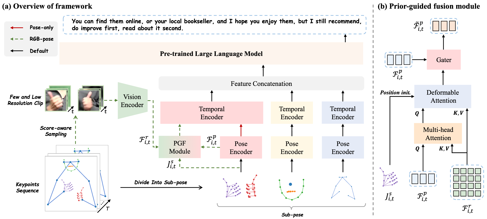

<h3 align="center">
Uni-Sign：面向大规模统一手语理解的多模态框架
</h3>

<h5 align="center">
如果这个项目对你有帮助，欢迎在 GitHub 上给项目点一个 Star。
</h5>

<h5 align="center">

[](https://arxiv.org/abs/2501.15187) 
[](https://huggingface.co/datasets/ZechengLi19/CSL-News)
[](https://pan.baidu.com/s/17W6kIreNMHYtD4y2llKmDg?pwd=ncvo)
[](https://huggingface.co/datasets/ZechengLi19/CSL-News_pose)
[](https://huggingface.co/ZechengLi19/Uni-Sign)

</h5>



## 项目简介

`Uni-Sign` 是一个面向手语理解任务的统一多模态框架，旨在在同一套模型结构下支持多种手语任务，包括：

- `SLT`：手语翻译（Sign Language Translation）
- `CSLR`：连续手语识别（Continuous Sign Language Recognition）
- `ISLR`：孤立词手语识别（Isolated Sign Language Recognition）

该框架的核心思路是：将手语视频中的姿态信息与可选的 RGB 视觉信息进行统一建模，再通过生成式语言模型输出自然语言文本或其他任务结果。

---

## 最新动态

- `[2025/1/25]` 论文被 `ICLR 2025` 接收。
- `[2025/2/24]` 发布 `CSL-News` 数据集与代码实现。
- `[2025/6/5]` 发布更轻量的姿态提取与在线推理实现，详见 [demo/README.md](./demo/README.md)。
- `[2025/12/20]` 发布 `How2Sign` 与 `OpenASL` 的 pose-only checkpoint 和推理代码，详见 [Hugging Face](https://huggingface.co/ZechengLi19/Uni-Sign)。

---

## 安装

建议创建一个新的 Conda 环境：

```bash
# 创建环境
conda create --name Uni-Sign python=3.9
conda activate Uni-Sign

# 安装项目依赖
pip install -r requirements.txt

# （可选）如果你需要在 How2Sign 或 OpenASL 上评估 BLEURT 分数
git clone https://github.com/google-research/bleurt.git
cd bleurt
pip install .
cd ../
wget https://storage.googleapis.com/bleurt-oss-21/BLEURT-20.zip .
unzip BLEURT-20.zip
```

说明：

- Windows 本地推理与 Ubuntu 训练环境可以分开配置
- 如果你当前使用的是 `RTX 50` 系显卡，应以你机器上实际验证可用的 PyTorch 与 CUDA 组合为准

---

## 数据准备

请按照 [docs/datasets/DATASET.md](./docs/datasets/DATASET.md) 中的说明准备原始数据。

如果你已经接入了自定义中文连续手语数据集，例如 `CE-CSL`，还需要额外完成：

- 标签转换
- pose 文件生成
- 数据路径注册

相关说明可参考：

- [Windows_Linux逐步运行清单.md](./docs/guides/Windows_Linux逐步运行清单.md)
- [CE-CSL数据集分析与Uni-Sign适配方案.md](./docs/datasets/CE-CSL数据集分析与Uni-Sign适配方案.md)

---

## 模型权重

Uni-Sign 的官方模型权重可以从以下地址下载：

- [Uni-Sign Hugging Face 权重页](https://huggingface.co/ZechengLi19/Uni-Sign/tree/main)

此外，本项目还依赖：

- `mt5-base`

通常建议将其放在：

```text
pretrained_weight/mt5-base
```

---

## 训练与评估

所有脚本都需要在 `Uni-Sign` 根目录下执行。

原始上游仓库的阶段脚本和较老的通用训练入口，现已归档到：

- `legacy/script/train_stage1.sh`
- `legacy/script/train_stage2.sh`
- `legacy/script/train_stage3.sh`
- `legacy/script/eval_stage3.sh`

对于当前这个本地 `CE-CSL` 研究项目，真正使用的入口请优先看：

- `docs/项目操作手册.md`
- `docs/Ubuntu项目操作指南.md`
- `docs/Round6_第三阶段测试命令清单.md`

当前本地项目真正的主训练入口是：

```text
local_sign_tools/finetune_cecsl_rgb_support.py
```

当前本地项目真正的主评估入口是：

```text
script/eval_cecsl_samples.py
```

---

## 推理与演示

如果你只是想快速看结果，而不想先完整配置训练环境与权重，也可以直接查看：

- [out](./out)

其中包含了部分 pose-only 手语翻译结果示例。

如果你想自己运行最小推理链路，可以重点看：

- [demo/online_inference.py](./demo/online_inference.py)
- [script/test_cecsl_forward.py](./script/test_cecsl_forward.py)

---

## 当前最推荐的使用方式

结合当前项目结构和中文连续手语改造路线，最推荐的使用方式是：

### Windows 本地

用于：

- 环境验证
- 最小前向测试
- 比赛演示
- 在线推理 Demo

### Ubuntu 服务器

用于：

- 全量 pose 生成
- `CE-CSL` 微调
- 训练与评估
- 论文实验

### 当前最推荐的实验主线

优先从下面这条路线开始：

```text
round6 主模型评估 -> stage2 受控训练 -> ablation -> 论文整理
```

原因是：

- 当前主线已经切换到 `CE-CSL + RGB-support + 两阶段训练`
- `round6` 是当前正式主模型
- 后续工作更偏向受控实验与论文整理，而不是再走早期 pose-only 流程

---

## 待办事项

- [x] 发布 `CSL-News` 数据集
- [x] 发布 `Uni-Sign` 代码实现
- [x] 发布姿态提取与在线推理实现

---

## 联系方式

如果你有任何问题，可以联系：

- Zecheng Li：`lizecheng19@gmail.com`

---

## 代码仓 / 数据仓分离

为了避免 `PyCharm` 对大体量视频、姿态文件、checkpoint 和预训练权重做全量索引，项目现在支持把数据与产物迁移到代码仓外。

- 统一路径配置：`paths.py`
- 本地覆盖文件：`paths.local.json`
- 一键迁移脚本：`script/migrate_storage.ps1`

推荐目录结构：

```text
E:\project\xiaozhi\Uni-Sign
E:\project\xiaozhi\Uni-Sign-storage
```

执行迁移：

```powershell
powershell -ExecutionPolicy Bypass -File script/migrate_storage.ps1
```

迁移后会自动生成 `paths.local.json`，训练、推理和 `view/` 演示模块都会优先读取这份本地路径配置。

---

## 致谢

Uni-Sign 的代码框架改编自：

- [GFSLT-VLP](https://github.com/zhoubenjia/GFSLT-VLP)

其中姿态编码器与时序编码器的部分实现来源于：

- [CoSign](https://openaccess.thecvf.com/content/ICCV2023/papers/Jiao_CoSign_Exploring_Co-occurrence_Signals_in_Skeleton-based_Continuous_Sign_Language_Recognition_ICCV_2023_paper.pdf)

同时，项目还受益于以下工作：

- [SSVP-SLT](https://github.com/facebookresearch/ssvp_slt)：优秀的手语翻译框架
- [MMPose](https://github.com/open-mmlab/mmpose)：开源姿态估计工具箱
- [FUNASR](https://github.com/modelscope/FunASR)：高性能语音转文本工具

---

## 引用

如果你在研究或应用中使用了 Uni-Sign，请引用以下 BibTeX：

```bibtex
@article{li2025uni,
  title={Uni-Sign: Toward Unified Sign Language Understanding at Scale},
  author={Li, Zecheng and Zhou, Wengang and Zhao, Weichao and Wu, Kepeng and Hu, Hezhen and Li, Houqiang},
  journal={arXiv preprint arXiv:2501.15187},
  year={2025}
}
```
