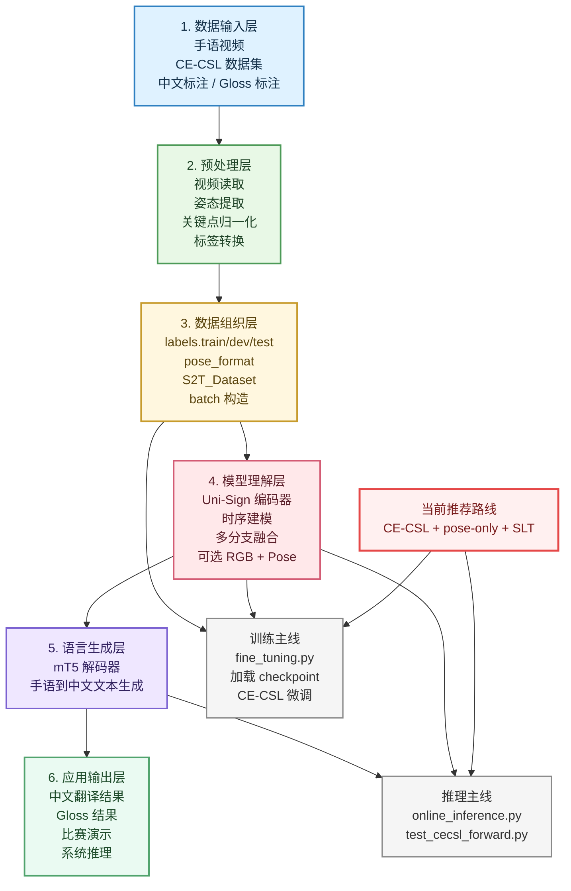

# PPT风格：彩色大模块中文版框架图

这张图更适合比赛答辩或项目汇报中的“大模块展示页”，强调系统分层、业务逻辑和落地方向。

## 使用建议

这张图适合放在 PPT 的“技术路线”或“系统架构”页，讲解时可以按下面顺序说：

1. 最上层是数据输入，包括手语视频和 `CE-CSL` 中文标注
2. 第二层先做姿态提取和标签转换
3. 第三层把数据整理成 Uni-Sign 可以直接读取的格式
4. 第四层由 Uni-Sign 完成手语时序理解和多分支融合
5. 第五层由 `mT5` 把手语特征翻译成中文文本
6. 最下层输出比赛演示结果、中文翻译结果和后续应用接口

当前你们项目最适合强调的点是：

- 不只是做“识别”
- 而是在做“连续手语理解与文本翻译”
- 并且已经把中文连续手语数据 `CE-CSL` 接入到了统一框架中
