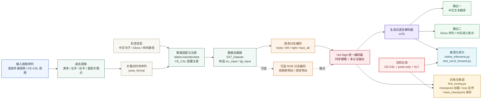

# 论文插图风格：Uni-Sign 中文框架图

这张图更接近论文中的“方法总览图”风格，强调模块关系、输入输出路径和研究主线。

## 图示说明

这张图的核心思想是：先把原始手语视频转换为结构化姿态序列，再通过 Uni-Sign 编码器做时序建模和多分支融合，最后对接 `mT5` 生成中文文本。

当前最值得强调的研究主线是：

- `CE-CSL` 数据适配
- `pose-only` 输入
- `SLT` 任务

这条主线已经完成：

- 标签转换
- pose 生成
- 数据注册
- 最小前向验证

后续则继续推进：

- `CE-CSL` 微调
- dev/test 评估
- `RGB + Pose` 扩展
