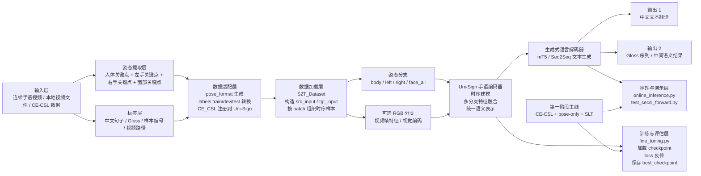
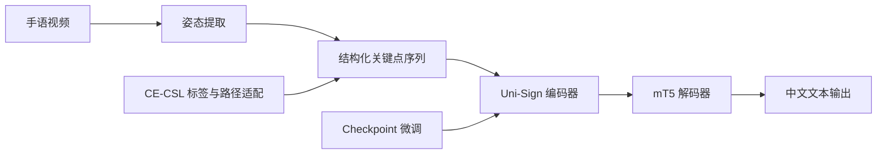

# 项目中文框架图

下面这张图是基于你当前项目实际结构整理出的中文技术框架图，重点体现：

- 手语视频输入
- 姿态提取
- `CE-CSL` 数据适配
- Uni-Sign 编码
- `mT5` 文本生成
- 推理与微调两条主线

你可以直接把这张图放到项目说明、PPT、答辩稿或论文草图里。

---

## 图示说明

### 1. 输入层

输入既可以来自：

- 本地手语视频
- 比赛展示视频
- `CE-CSL` 数据集中的原始视频

同时，每个样本还配有：

- 中文文本标注
- gloss 标注
- 视频路径

### 2. 姿态提取层

这一层先把原始视频转换为结构化关键点序列，是当前项目最稳定的主输入路线。  
关键点主要包括：

- 身体
- 左手
- 右手
- 面部

### 3. 数据适配层

这是你当前做得最关键的一层。  
它的作用不是训练模型，而是把 `CE-CSL` 这种原始数据整理成 Uni-Sign 能直接读的格式，包括：

- `pose_format/*.pkl`
- `labels.train`
- `labels.dev`
- `labels.test`

### 4. 数据加载层

这一层由 `S2T_Dataset` 实现，负责把：

- 标签
- pose
- 可选 RGB

统一组织成模型输入。

### 5. Uni-Sign 编码器

这一层是手语理解的核心。  
它负责：

- 对关键点时序进行编码
- 对不同身体区域进行建模
- 对多模态特征进行融合
- 生成可供文本解码器使用的高层语义表示

### 6. 文本生成层

这一层由 `mT5` 承担，负责把手语编码结果映射成自然语言文本。  
也正因为这里用了生成式语言模型，项目才能实现：

- 句子级翻译
- 不只是单类别识别

### 7. 两条主线

当前项目有两条最重要的主线：

1. 推理与演示主线  
用于比赛展示和最小效果验证

2. 微调与训练主线  
用于后续把模型真正适配到 `CE-CSL`

### 8. 当前最推荐路线

从工程稳定性和研究推进角度，当前最推荐的路线是：

`CE-CSL + pose-only + SLT`

原因是：

- pose 链路已经打通
- 数据已经适配
- 最小前向已经验证成功
- 最适合先做第一版中文连续手语微调

---

## 论文风格简化版框架图

如果你想在 PPT 或论文草图里用更简洁的一版，可以用下面这个：

---

## 建议用途

这份中文框架图最适合用在：

- 项目总览页
- 技术路线页
- 比赛答辩架构页
- 论文初稿中的方法总览草图

如果你后面还想要更像论文插图的版本，我可以继续给你做两种：

1. 更正式的“横向模块框图”中文论文版
2. 更适合答辩 PPT 的“彩色分层架构图”中文版
